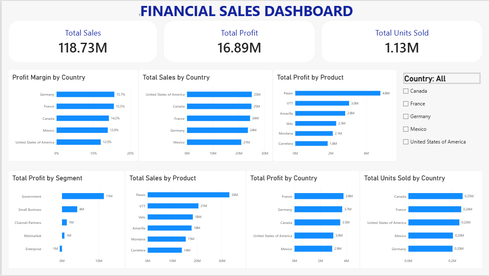

# Financial Sales Analysis Dashboard

## Project Overview
This project explores financial sales data using Power BI to identify trends in sales, profitability, product performance, and country-level performance.

The interactive dashboard allows users to explore key metrics and compare performance across countries.

## Tools Used
- Microsoft Power BI
- DAX (Data Analysis Expressions)
- Data visualization and business analysis

## Key Performance Indicators
- **Total Sales:** 118.73M
- **Total Profit:** 16.89M
- **Total Units Sold:** 1.13M

## Key Business Insights
- **Country Performance:** The United States recorded the highest total sales, at approximately 25M, while Mexico recorded the lowest, at approximately 21M.
- **Profitability:** France generated the highest total profit, at approximately 3.8M.
- **Profit Margin:** Germany had the highest profit margin, at approximately 15.7%, while the United States had the lowest, at approximately 12%.
- **Product Performance:** Paseo was the leading product in both sales and profit, while Carretera had the lowest total sales and profit.
- **Segment Analysis:** The Government segment generated the highest profit, at approximately 11.4M, while Enterprise recorded a loss of approximately 0.6M.

## Dashboard Preview

## Files Included
- `Financial_Sales_Analysis.pbix` — Power BI dashboard file
- `dashboard_screenshot.png` — Dashboard preview
- `README.md` — Project documentation

## Dataset
This project uses the sample Financials dataset provided for Power BI practice.

## Conclusion
This project demonstrates the use of Power BI to create an interactive dashboard and communicate business insights through data visualization.